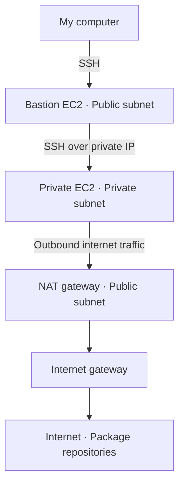

# Week 5 – VPC and Networking

This week, I created an AWS network with public and private subnets across two Availability Zones. I used a bastion server in the public subnet to connect to an EC2 instance in the private subnet. I also set up a NAT gateway so the private instance could access the internet without having a public IP, and tested it by running the update command. I learned how route tables control where traffic goes and security groups control which connections are allowed. Once I finished, I deleted the lab resources to avoid ongoing charges.

## Architecture Flow

## What I did
- Created a VPC with two public and two private subnets across two Availability Zones.
- Launched a bastion EC2 instance in a public subnet and another EC2 instance in a private subnet.
- Allowed SSH to the bastion from my IP and SSH to the private instance from the bastion’s security group.
- Connected through the bastion using SSH agent forwarding, keeping my private key on my laptop.

## How traffic flows
For SSH, I connected from my computer to the bastion’s public IP, then from the bastion to the private instance using its private IP.

For internet access, the private instance sends outbound traffic through the NAT gateway in the public subnet, then through the internet gateway. The private instance does not need a public IP.

The public subnets route internet traffic to the internet gateway. The private subnets route internet traffic to the NAT gateway.

## Cleanup
Terminated both EC2 instances, deleted the NAT gateway, released its Elastic IP, and deleted the training VPC.
