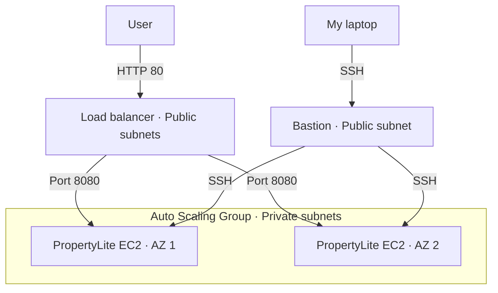

# Week 6 – Load Balancing and Auto Scaling

This week, I deployed PropertyLite behind a load balancer with an Auto Scaling Group running two app servers in private subnets. I tested automatic replacement by terminating one server, and AWS started launching its replacement about two minutes later. I also connected through a bastion and ran a five minute CPU test. CPU usage increased, but no additional servers were launched. I learned that the scaling policy looks at average CPU across the group, so putting load on only one server may not be enough to trigger scaling.

## What I learned
I learned how a load balancer sends requests to healthy instances and how Auto Scaling replaces a terminated server. I also learned that high CPU on one instance does not necessarily push the group average above the scaling target.

## Architecture

The load balancer routes requests to healthy app servers. Auto Scaling replaces terminated instances and targets 50% average CPU, with capacity between 1 and 4 instances. The bastion provides SSH access for testing.