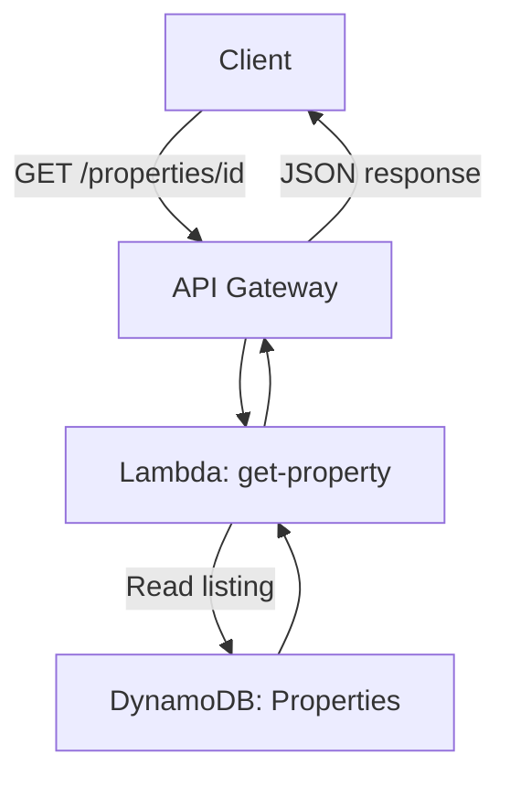

# Week 7: Serverless API and Message Queues

## What I Did

This week, I built an API using Lambda, API Gateway, and DynamoDB. The API takes a listing ID and returns the matching property. I also created an SQS queue, sent and received test messages, and configured a dead letter queue for messages that repeatedly fail processing.

## Architecture

## What I Learned

DynamoDB returns numbers as Decimal values, which Python cannot directly convert into JSON. I added a conversion function so the property price could be returned correctly. I also learned that receiving an SQS message does not delete it. It becomes temporarily hidden and can appear again if it is not deleted.

Lambda runs the code without me managing an EC2 instance. API Gateway provides the HTTP endpoint, and the Lambda role limits database access to reading items from the Properties table.
